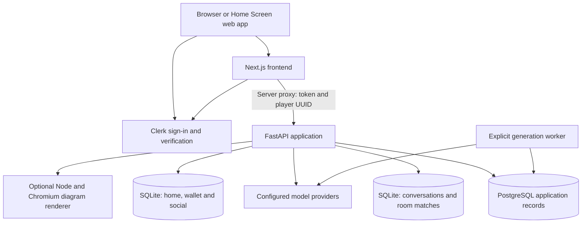

# QuestNest: project and architecture guide

QuestNest turns a learner's schoolwork into explanations, visual lessons, practice and shared games. Learners can upload notes, ask questions, review mistakes, compete with friends or family, and spend earned coins on a personal base and character items. The purpose is to connect individual study with an activity people can do together.

This is the starting point for understanding the whole project. Implementation details stay with the repository that owns them.

## Documentation map

| Read this | To understand |
| --- | --- |
| [Frontend README](../README.md) | Install and run the web application |
| [Frontend architecture](FRONTEND_ARCHITECTURE.md) | Routes, components, state, API clients and rendering |
| [Development and integration](DEVELOPMENT.md) | Connect both services, validate changes and diagnose failures |
| [Frontend decisions](DECISIONS.md) | Why the frontend is structured this way and its tradeoffs |
| [Session contract](SESSION.md) | Clerk accounts, player UUIDs and proxy behavior |
| [Signup](SIGNUP.md) | Registration, email verification and the family-consent boundary |
| [Social integration](SOCIAL_API.md) | Friends, presence and live duel wiring |
| [Integration journeys](INTEGRATION_TESTING.md) | Connected screens and manual acceptance scenarios |
| [Backend README](https://github.com/Vl4dC/Parent-Child-Bonding-Game-Backend) | FastAPI setup and backend documentation index |
| [Backend architecture](https://github.com/Vl4dC/Parent-Child-Bonding-Game-Backend/blob/main/docs/ARCHITECTURE.md) | Storage, generation, workers and gameplay engines |
| [Backend API](https://github.com/Vl4dC/Parent-Child-Bonding-Game-Backend/blob/main/API.md) | API families and detailed endpoint contracts |
| [Product plan](PRODUCT_PLAN.md) | Product ambitions and backlog; not an implementation checklist |

The companion backend documentation change adds `docs/DECISIONS.md` and `docs/OPERATIONS.md` in that repository. Cross-repository GitHub links describe the intended merged location; local documentation changes must be published there before new or revised content appears on GitHub.

## Evidence and scope

Reviewed on **25 October 2026** against frontend **`67b663f`** and backend **`a85ec74`**. The frontend snapshot includes the local launch branch's Home Screen installation and light-theme changes, two commits beyond the locally cached `origin/main` (`edca4d4`). A fresh frontend fetch failed with “Repository not found”; no claim is made that this is the latest remote frontend. Backend `origin/main` was fetched successfully.

Descriptions below come from route handlers, API clients, stores, generation engines, migrations and tests. “Implemented” means code exists in these snapshots; it does not certify the deployed service, provider quality or successful end-to-end execution. The decision records distinguish explicitly recorded choices from rationale inferred from the implementation.

## 1. Product model

The core journey is:

1. **Bring context.** Upload a PDF or photos, or type a topic. Extracted pages can be inspected and corrected.
2. **Understand.** Generate an explanation at a requested reading level, with diagrams or other visuals where useful. Ask follow-up questions in a saved conversation.
3. **Practise.** Answer questions, revisit weak areas, or review cards. Attempts retain their question snapshot so later edits do not rewrite past results.
4. **Play together.** Use a same-device duel, a live friend duel, or a private room game.
5. **Build continuity.** Record completion, collect eligible rewards, claim quests and customize a base or character.

This grouping is reflected in the navigation: **Learn**, **Chat**, **Play**, **Base**, **Shop**, **Friends** and **Quests**. Private quizzes and flashcards now live under Play → Solo. The original `/learn/quiz/:id` and `/learn/flashcards/:id` addresses redirect to those screens.

The educational rationale is an inference: explanations, recall, feedback and shared play give learners several ways to return to the same material. The repositories do not contain a controlled study proving improved learning outcomes.

## 2. System overview



The frontend repository owns browser behavior, presentation, assets, Clerk integration and same-origin proxy routes. The backend repository owns domain APIs, generated content, persistence, timing, scoring and rewards. Both can evolve independently as long as the contract between them remains compatible.

There is **one supported backend application factory**, `app.main:create_app`. The `learning_service/` package is integrated into that application. Historical static learning-service files are retained for reference; they are not a second frontend to run alongside QuestNest.

### Request path

For a signed-in learner opening a saved lesson:

```text
Lesson screen
  → lib/learn-api.ts
  → GET /api/lessons/<id> on Next.js
  → lib/server/learning-session.ts
  → GET <LEARNING_API_URL>/api/lessons/<id> on FastAPI
  → request-local player partition and repository
  → public lesson response, with no-store caching
```

The browser does not select the upstream server or forward its own player header through this proxy. Next.js obtains the current Clerk session and adds its associated player UUID. Upload bodies are streamed upstream rather than decoded and reconstructed by the proxy.

## 3. Identity and trust

Three identifiers serve different purposes:

| Identifier | Meaning | Used for |
| --- | --- | --- |
| Clerk `sub` | Provider account ID | Signed-in identity and public social user IDs |
| `player_id` | Stable UUID saved in Clerk public metadata and signed into the session token | Existing learning, home and wallet partitions |
| Resource IDs | Lesson, quiz, room, match, conversation or race IDs | Individual domain objects |

The frontend requires Clerk sign-in for application pages and forwarded API calls. This is useful protection at the web entry point, but it is not the backend's whole access model:

| Backend route family | Actual identity contract |
| --- | --- |
| `/api/social/*` | Verifies Clerk JWT signature, issuer, required time/session claims and player binding; checks `azp` against configured parties when present; rejects a conflicting player header |
| Other `/api/*` routes | Accept an unverified `X-Player-ID`; no token verification. Without the header, all callers share the default player |
| Guardian request workflow | Uses receipts, decision proofs and request authority; direct backend mailbox/player filters remain caller-supplied |

This scoped verification is an explicitly recorded backend decision, not a claim that all data is protected by Clerk. Anyone who can reach a legacy endpoint can choose another player's UUID. PostgreSQL RLS partitions rows by the selected UUID but cannot turn that unverified selector into a verified identity. Parent/learner labels also do not establish guardianship or family access.

The frontend guardian proxy additionally binds its mailbox query to the signed-in user's verified primary email. Direct backend access does not inherit that check. Read [SESSION.md](SESSION.md) before changing identity behavior.

## 4. Main journeys across both repositories

### Upload to lesson

`/learn/new` starts the conversation/upload flow. Material screens show extracted text, page selection and corrections. Backend extraction uses local text reading where possible, vision for image pages, and optional embeddings for semantic topic search. Embedding failure can fall back to keyword search with a warning.

Only extracted material text and derived records are retained; uploaded source images are not retained as original files. A material revision must be confirmed before generation uses it. Page ranges, chapter selection and topic search limit the source passed into a grounded lesson. Returned source metadata identifies the material revision and pages used.

The backend generates a draft structured lesson, applies content checks and saves it in the selected partition. Visual generation uses the lesson's planned visuals or an explicit learner request. The frontend displays complete visual documents inside sandboxed frames.

Material confirmation is a technical checkpoint. The client has an `ensureConfirmed` helper that can confirm the latest revision; a confirmed flag does not prove a person carefully reviewed every extracted word. Lesson and question-set approval similarly record owner confirmation, not independent teacher review.

### Lesson to private practice

The lesson screen can create a quiz or deck. The solo quiz screen resumes recorded first answers, submits with idempotency keys and expected counters, finishes the attempt and offers review, retries or mistake cards. A deterministic retry reuses saved questions; a generated weak-spot follow-up is a different operation that can call models.

Question edits create a new immutable snapshot. Historical attempts keep the original questions. Flashcard “know/again” reviews update a saved loop; restarting creates a fresh pass over the same content without another model call.

### Saved chat

The client creates or reopens a backend conversation and passes `conversation_id` into text or picture chat. The backend saves messages and retrieval metadata in `MEMORY_DB_PATH`; longer histories can be folded into summaries for model context. Original picture attachments are processed for the request rather than saved as image files.

PDF chat exposes `used_pdf` and referenced pages. `auto` mode may answer without the book; `pdf_only` restricts the answer to it. Grounding and citations improve traceability, but do not establish that every generated claim is correct.

### Play together

There are distinct paths, with different contracts:

| Path | Content and play |
| --- | --- |
| Same-device family duel | Tournament question set; two answer sheets on one device; the selected account owns the wallet and the second sheet is a guest |
| Friends live duel | Verified `/api/social` profile/friendship, invitation, server countdown, answers and results; automatic reward settlement |
| Private room match | Lobby membership and readiness, challenge creation, server-clocked MCQ/Heads-up/diagram engines, results and explicit eligible reward claims |
| Saved-diagram assembly | Optional feature: freeze a reviewed lesson flowchart, study it, then reconstruct its labels in a simultaneous race |

Rooms are lobbies; matches are game executions. Joining a room is not the same as participating in a match created before joining. Current room members who were captured as match participants can discover the match and reconnect. Host actions, timers and scoring are validated on the backend against the selected participant contract.

Heads-up uses a phone-to-forehead reveal step and buttons for correct/skip/violation; it does not implement tilt controls. The normal diagram match uses tap-to-select and tap-to-place labels. The separate saved-diagram feature freezes one rendered SVG and removes labels from a clone, preserving geometry without asking a model to redraw it.

### Rewards and customization

The backend wallet is shared across quiz rewards, duels, participation, quests, shop and base. Clients submit resource/item IDs, not trusted scores, prices or coin balances. Claims and purchases use persisted results and unique ledger references so retries do not pay or charge twice.

A first-time wallet starts at 240 coins. Quiz first-answer rewards pay 10 coins per eligible correct answer. Completed qualifying games can earn 20 participation coins. A five-question perfect quiz can therefore yield 50 answer coins plus 20 participation coins before quests. Duel settlement already includes the participation component; it is not another extra 20 coins.

Quests use Europe/Berlin calendar days and Monday-start weeks, including daylight-saving changes. The client submits the displayed period when claiming, so an old screen cannot silently claim a new period. Clothing/accessories cost 100 coins in the server catalog; whole-character looks have separate prices. See the [economy contract](https://github.com/Vl4dC/Parent-Child-Bonding-Game-Backend/blob/main/docs/ECONOMY.md) for exact eligibility and prices.

## 5. Where state lives

| Store | Canonical data | What restart or device change means |
| --- | --- | --- |
| Clerk | Accounts, credentials/session lifecycle, user metadata and player binding | Requires the configured Clerk instance; not backed up with app databases |
| PostgreSQL | Learning records, immutable question sets, attempts, completion/events, jobs, rooms, approval workflow, saved-diagram races | Durable when the configured database and migrations are retained |
| `memory.db` or `MEMORY_DB_PATH` | Conversations/messages, study digests, generated challenges, room matches and weekly samples | Must be preserved separately from PostgreSQL |
| `home.db` or `HOME_DB_PATH` | Homes, wallet/ledger, inventory/equipment, friendships, presence and live social duels | Must be preserved separately; independent files mean independent balances/social state |
| Browser local storage | UI cache, recent ordering, study plans, local streak and display preferences | Device-dependent; clearing it loses local-only features, not canonical server records |

In explicit backend demo mode, the PostgreSQL repository is replaced with process memory if no database URL is configured. That does **not** automatically make the SQLite stores ephemeral; outside test mode they still default to files. `/ready` reports the application repository's durability, not a full backup or all-service readiness guarantee.

The browser store still contains legacy coin/progress fields and helper functions. Connected screens replace them with API results. Neither these values nor a local unlimited-coins flag authorize spending on the server. See [frontend state architecture](FRONTEND_ARCHITECTURE.md#state-and-synchronization).

## 6. Implemented, conditional and remaining

| Area | Status in the reviewed code |
| --- | --- |
| Clerk login/signup and verification | Connected frontend flow |
| Materials, lessons, practice, cards, chat and library | Connected to backend; generation needs configuration and provider access |
| Wallet, shop, equipment, quests and base | Connected; modular clothing selection is persisted, but the preview still renders a whole-character look |
| Friends, presence and live duels | Connected verified social proxy; requires correct Clerk claims and issuer |
| Room MCQ, Heads-up and diagram matches | Connected engines and UI; no blanket claim that every party-game card is playable |
| Background generation | Connected queue UI; PostgreSQL and separately running worker required |
| Saved-diagram assembly | Connected optional UI/API; feature flag, schema and renderer required |
| Learner approval requests | Optional separate workflow in family settings; not the mandatory Clerk registration path |
| Weekly tournament | Preview/sample experience; example standings are not a live ranked competition |
| Study plans and streaks | Device-level state; no canonical backend plan/streak service |
| Family authorization | Role labels and email verification do not establish verified guardian-child linkage |
| AI output quality | Structured generation, review and safety controls exist; no guarantee of correctness or age suitability |
| Scale | Current SQLite interfaces target a single application host; distributed deployment requires storage consolidation |

Fact Check and unsupported party-game engines remain outside the connected delivery. Installability means a manifest, icons and standalone display; the app still needs internet for sign-in, server content and multiplayer. There is no offline synchronization contract.

## 7. How to explain the architecture

The strongest case for the design is the separation of responsibilities: Next.js owns an accessible responsive experience and session-aware entry point, while FastAPI owns reusable learning engines and deterministic gameplay rules. Generated material is versioned and reusable; repeated practice and saved-diagram play can avoid repeated generation. Server-owned ledgers and clocks make reconnection and retry behavior understandable.

The costs are equally concrete: two runtimes, a hybrid persistence model, scoped rather than universal backend authentication, polling traffic, and model-dependent content quality. These are engineering constraints to manage, not evidence that all production-readiness work is finished. [Frontend decisions](DECISIONS.md) and the backend decision record explain when each choice should be revisited.
